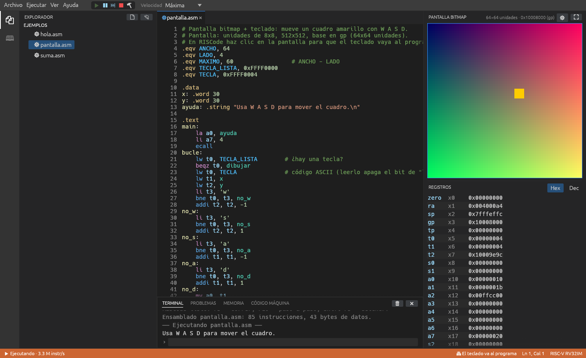

# RISCode

Editor y simulador de ensamblador **RISC-V** con cara de VS Code. Escribes tu `.asm`, presionas
**F5** y corre, con la **pantalla bitmap** y el **teclado** ya conectados. No hay que configurar
nada como en RARS.



## Qué trae

- **Editor**: colores para instrucciones, registros, etiquetas, constantes `.eqv` y comentarios;
  números de línea; los errores salen subrayados en rojo; al pasar el mouse explica cada
  instrucción y muestra el valor de los registros.
- **Ensamblador compatible con RARS**: genera exactamente el mismo código máquina que RARS 1.6
  (hay tests que lo comparan palabra por palabra). Soporta RV32IM, las pseudoinstrucciones de
  RARS, `.eqv`, `.data`/`.text`, `.word`, `.half`, `.byte`, `.space`, `.string`, `.ascii`, `.align`.
- **Simulador**: el mismo mapa de memoria de RARS (`.text` 0x00400000, `.data` 0x10010000,
  `gp` 0x10008000, pila 0x7FFFEFFC) y sus syscalls (1, 4, 5, 8, 9, 10, 11, 12, 17, 30, 32,
  34-36, 40-42). Los números aleatorios usan el mismo generador que Java, así que con la misma
  semilla salen igual que en RARS.
- **Pantalla bitmap** y **teclado MMIO** (0xFFFF0000 / 0xFFFF0004) siempre conectados.
- **Depuración**: paso a paso, puntos de parada (clic en el número de línea), velocidad
  ajustable, registros que se resaltan al cambiar, vista de memoria y de código máquina.
- **Exportar código máquina** en binario o hexadecimal, igual que el Proyecto 3.

## Cómo correrlo

Necesitas Rust. En Fedora:

```bash
sudo dnf install rust cargo
```

Luego, dentro de esta carpeta:

```bash
cargo run --release                                   # abre RISCode
cargo run --release -- ejemplos/pantalla.asm --correr # abre un ejemplo y lo corre
```

Para correr los tests (incluye la comparación contra RARS):

```bash
cargo test --workspace
```

## Atajos

| Tecla        | Acción                                  |
|--------------|-----------------------------------------|
| F5           | Correr / continuar                      |
| F6           | Pausar                                  |
| F10          | Paso a paso                             |
| Shift+F5     | Detener                                 |
| F9           | Poner/quitar punto de parada            |
| Ctrl+B       | Solo ensamblar                          |
| Ctrl+S       | Guardar                                 |
| Ctrl+O       | Abrir archivo (Ctrl+Shift+O: carpeta)   |
| Ctrl+J       | Mostrar/ocultar el panel de abajo       |

Mientras el programa corre, el teclado va al programa (para jugar). Si haces clic en el
editor, el teclado vuelve al editor. Para devolverlo al programa, haz clic en la pantalla.

## Cómo está hecho

```
crates/riscode-asm   Ensamblador de dos pasadas (la versión en Rust del Proyecto 3)
crates/riscode-sim   CPU RV32IM, memoria, syscalls, pantalla y teclado
app                  La interfaz (egui), estilo VS Code
ejemplos             Programas de ejemplo
```

## Créditos

- El ensamblador viene del **Proyecto 3** de Diseño de Sistemas Digitales (TEC), de
  Steven e Isabel Sevilla.
- El comportamiento sigue a [RARS](https://github.com/TheThirdOne/rars) (licencia MIT), que se
  usó como referencia para comprobar que el código máquina sea idéntico.

Licencia MIT.
